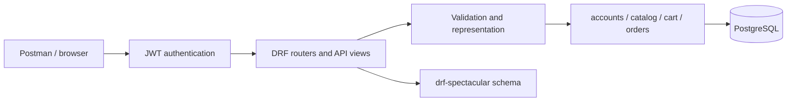
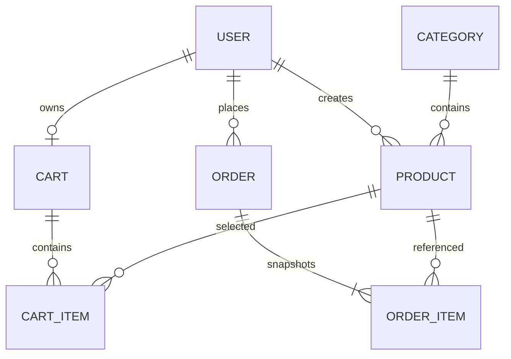

# Architecture and interview guide

## Request architecture

Django owns configuration, URL dispatch, ORM transactions, password hashing and admin integration. DRF serializers validate request bodies; viewsets implement resource behavior; permission classes separate public reads, staff catalog writes and authenticated customer operations. The database is the durable source of truth. PostgreSQL is selected through environment variables; SQLite is a local test fallback.

## Entity relationships

`Cart.user` is one-to-one; `(cart, product)` is unique. Category deletion is protected while products reference it. Cart/order line quantities and monetary values have database check constraints. `OrderItem` snapshots product name and unit price so later catalog edits do not change historical receipts. Order/product foreign keys are protected against deletion where history exists.

## Endpoint inventory

| Method | Route | Access | Behavior |
|---|---|---|---|
| POST | `/api/v1/auth/register/` | Public | Create account |
| POST | `/api/v1/auth/login/` | Public | Issue access and refresh JWT |
| POST | `/api/v1/auth/refresh/` | Public | Rotate access/refresh token |
| GET | `/api/v1/auth/profile/` | JWT | Read current profile |
| GET, POST | `/api/v1/categories/` | Public read / staff write | List and create categories |
| GET, PUT, PATCH, DELETE | `/api/v1/categories/{id}/` | Public read / staff write | Category CRUD |
| GET, POST | `/api/v1/products/` | Public read / staff write | Paginated/filterable products and create |
| GET, PUT, PATCH, DELETE | `/api/v1/products/{id}/` | Public read / staff write | Product CRUD |
| GET | `/api/v1/cart/` | JWT | Current cart with total |
| GET, POST | `/api/v1/cart/items/` | JWT | List/add items |
| GET, PUT, PATCH, DELETE | `/api/v1/cart/items/{id}/` | JWT owner | Retrieve/update/remove own item |
| POST | `/api/v1/orders/checkout/` | JWT | Atomically place order from cart |
| GET | `/api/v1/orders/` | JWT | List own orders |
| GET | `/api/v1/orders/{id}/` | JWT owner | Retrieve own order |
| POST | `/api/v1/orders/{id}/cancel/` | JWT owner | Cancel pending order and restore stock |
| GET | `/api/schema/` | Public | OpenAPI JSON |
| GET | `/api/docs/` | Public | Swagger UI |
| GET | `/api/redoc/` | Public | ReDoc |

This is 29 method/route combinations, counting cart-item CRUD and router-supported detail actions. Inactive catalog behavior is exposed as soft visibility: only active products appear in listing; catalog writes are staff-gated.

## JWT flow

1. Client posts email and password to login. Django verifies the stored password hash; SimpleJWT returns a short-lived access token and longer-lived refresh token.
2. Client sends `Authorization: Bearer <access>` for protected calls. DRF's JWT authentication validates signature, expiry, token type and user before permission checks.
3. When access expires, client posts its refresh token to `/auth/refresh/`; refresh rotation returns a new pair. Clients should replace both stored tokens.
4. Passwords are never returned; Django's password validators and password hasher are used during registration.

## Modules and design decisions

- **accounts**: custom email-login user model, registration serializer, and authenticated read-only profile. Custom user was created before initial migrations to avoid a fragile later swap.
- **catalog**: categories and products; slug/SKU uniqueness, nonnegative price/stock constraints, lookup indexes, category protection, search and ordering. Staff-only mutations protect catalog integrity.
- **cart**: one cart per user and unique product line. Adding an existing product increments quantity; quantity must be positive and within current stock. Querysets are owner-scoped to prevent IDOR.
- **orders**: checkout locks cart/product rows inside a transaction, validates stock, snapshots prices, decrements inventory and clears cart atomically. Cancellation only applies to pending orders, locks the order and restores inventory.
- **config**: environment-selected database, global DRF pagination/filtering/throttling, JWT lifetimes and generated OpenAPI documentation.

Money uses `DecimalField`, never binary floating point. Checkout uses transactions and row locks so concurrent purchases cannot both spend the same inventory in PostgreSQL. SQLite tests validate functional behavior but do not prove PostgreSQL row-lock behavior; run integration tests against PostgreSQL before a real deployment.

## Interview questions and sample answers

### Why use a custom user model?
Email is the login identifier, so `AUTH_USER_MODEL` is configured before migrations. Changing a user model after production migrations is disruptive; deciding early keeps authentication relationships stable.

### What is the difference between access and refresh tokens?
The access token is short lived and accompanies API calls. The refresh token lasts longer and is exchanged only to mint a fresh access token. Short access lifetime limits exposure; rotation limits reuse windows. Production systems should also revoke/blacklist refresh tokens and protect client storage.

### How do you prevent one customer from reading another customer's cart or orders?
Each view derives its queryset from `request.user` and never accepts an owner ID from the client. Looking up an object outside that queryset returns 404, avoiding both access and existence leaks.

### How do you handle inventory races during checkout?
Checkout runs in `transaction.atomic`, locks the cart lines and product rows with `select_for_update`, validates stock while locked, then writes order lines, decrements stock and clears the cart. PostgreSQL serializes competing updates to those locked rows.

### Why snapshot unit price and name on order lines?
The product catalog changes over time. A receipt must reflect what the customer bought and paid at checkout, so order lines preserve the name and price independently of later edits.

### Why use DecimalField for price?
Decimal arithmetic represents base-10 currency exactly to configured precision. Binary floats can introduce rounding error in totals.

### Why protect category and product deletion?
Foreign-key `PROTECT` avoids silently invalidating catalog references and historical order lines. A future production API could add archival/soft-delete workflows.

### What does serializer validation do versus a database constraint?
Serializer validation returns useful client errors before writes. Database constraints are the final integrity boundary and also protect writes from admin code, scripts, races, or other APIs.

### What does idempotency mean for checkout?
Repeating a checkout request should not create duplicate purchases. This demo returns an error once the cart is empty, but production checkout should accept an idempotency key, store its outcome under a unique constraint, and replay that response.

### How would you scale the product listing?
Keep pagination bounded, select related category rows, index common filters, inspect query plans, cache stable public catalog responses, and move to cursor pagination for rapidly changing large result sets.

### What is the purpose of OpenAPI?
OpenAPI describes paths, parameters, security and payload schemas in a machine-readable format. Swagger UI gives humans an interactive client and generated clients can consume the schema.

### What remains before production?
Payment integration, addresses/tax/shipping, idempotency, refresh revocation, structured audit logs, observability, PostgreSQL-backed concurrency tests, deployment secrets, HTTPS, backups and load/security testing.

## Verification distinction

The implementation in this repository is newly created for this task. Any results in `reports/test-report.txt` refer only to the exact test execution recorded there. No earlier project or historical test results are claimed.
